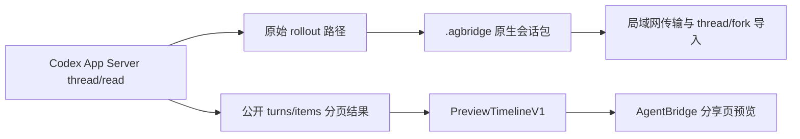

# Codex 全保真会话预览设计

日期：2026-11-13  
状态：已确认

## 背景

AgentBridge 当前已经通过 `.agbridge` 原生会话包分享 Codex 的原始 rollout，接收方导入时使用这份原始数据。但分享页的预览来自一套较早的简化的 `SnapshotV1`：

- 只保留用户文本、助手文本和部分工具结果。
- 命令执行、文件修改、图片附件、未知条目等被转换或折叠。
- 疑似凭据会在预览快照中隐藏。
- 警告使用“已省略不支持的内容”等措辞，容易被理解为原生分享也丢失了内容。

因此，实际分享与预览之间存在明显的保真度差异。新的设计要把两者明确分开：

- `.agbridge` 原生包负责完整复制 Codex 会话。
- AgentBridge 预览负责像 Codex 一样展示会话结构和内容。
- 预览中的折叠、脱敏和可读性处理不能改变接收方最终导入的原生历史。

## 目标

1. 分享页使用与 Codex 接近的对话时间线展示会话。
2. 保留用户消息、助手回复、计划、思考摘要、命令执行、文件修改、MCP 工具、Web 搜索、图片引用、未知条目和错误状态的顺序与类型。
3. 命令输出、文件 diff、长文本、原始 JSON 和疑似敏感内容默认折叠，用户可以逐项展开。
4. 明确说明所有折叠和敏感内容处理只影响预览，不改变 `.agbridge` 原生包。
5. 接收方导入继续使用未经改写的原始 rollout。
6. 不再使用“不支持分享”或会暗示分享内容丢失的文案。

## 非目标

- 本轮不改变局域网配对、TLS、邀请有效期或传输安全模型。
- 本轮不改变 `thread/fork` 原生导入方式。
- 本轮不把接收方确认页改为完整对话阅读器。接收方仍只查看元数据，避免在用户确认前额外暴露完整正文。
- 本轮不增加云端预览、多人协作或跨互联网分享。
- 本轮不取消现有原生包 256 MiB 上限。超过上限时必须明确报错，不能静默裁剪。

## 方案选择

### 方案 A：继续扩展 `SnapshotV1`

直接给 `SnapshotV1` 增加命令、diff、图片、未知条目等字段。

优点是改动集中；缺点是 `SnapshotV1` 同时承担传输元数据、旧版续接提示和 UI 预览，继续扩展会让兼容责任混杂，并可能把完整正文发送给尚未接受分享的接收方。

### 方案 B：新增本地 `PreviewTimelineV1`，原生包保持权威

新增独立预览模型，只用于分享方本机 UI。`.agbridge` 和接收方使用的 `SnapshotV1` 元数据保持现状。预览从同一批公开 Codex App Server 条目生成，不对原生 rollout 做任何改写。

这是推荐方案。它把“显示”和“传输”解耦，可以减少接收方过早获得完整正文的风险，也避免预览结构变化影响原生导入协议。

### 方案 C：前端直接解析 `.agbridge`

生成包后由前端解析 rollout 并渲染。

优点是只依赖一个数据源；缺点是前端要理解 Codex 私有 rollout 格式，兼容成本高，也容易把解析失败误认为分享失败。因此不采用。

## 总体架构



- `thread/rollout` 路径及其依赖文件继续构成唯一分享数据源。
- 预览从公开 App Server 条目生成，不解析或改写即将发送的 rollout 内容。
- 预览注册表按现有方式与会话 ID、截止轮次和 `previewId` 绑定。
- 创建邀请时仍要求匹配的会话和已生成预览。

## 预览数据模型

新增版本化 `PreviewTimelineV1`，只通过本机 Tauri 命令返回：

```text
PreviewTimelineV1
├── schemaVersion
├── sourceThreadId
├── cutoffTurnId
├── turns[]
│   ├── id
│   ├── index
│   ├── status
│   ├── startedAt
│   ├── completedAt
│   └── items[]
│       ├── id
│       ├── kind
│       ├── title
│       ├── status
│       ├── timestamp
│       ├── sensitive
│       └── blocks[]
│           ├── kind: text | code | diff | json | image | error
│           ├── label
│           ├── content
│           ├── sensitive
│           └── defaultExpanded
└── notices[]
    ├── code
    ├── count
    ├── message
    └── scope: display_only
```

结构约束：

- `turns` 和 `items` 保持 App Server 返回的先后顺序。
- 未知条目使用 `kind: "unknown"` 和原始 JSON 块，不再丢弃。
- 命令执行即使没有输出，也保留命令、状态、退出码和时长。
- 文件修改按文件生成可折叠 diff 块。
- 图片附件保留路径或引用信息；预览不复制图片二进制。
- 工具调用和结果保留名称、参数摘要、输出或错误。
- 单个块保留完整文本，不因预览而截断；UI 通过折叠控制阅读负担。
- 疑似凭据标记为 `sensitive: true`，原文仍然存在于数据结构中，默认隐藏。

## 后端数据流

生成分享预览时：

1. 读取截止轮次之前的公开 turns/items。
2. 同时生成现有 `SnapshotV1` 和新的 `PreviewTimelineV1`。
3. 将 `SnapshotV1`、`PreviewTimelineV1` 与原生 `.agbridge` 一起写入预览注册表。
4. 前端只接收 `PreviewTimelineV1` 用于分享页展示。
5. 创建分享邀请时只发送现有 `SnapshotV1` 元数据和原生包；`PreviewTimelineV1` 不进入局域网协议。

这样可以在不破坏接收方兼容性的前提下逐步扩展预览。

## 分享页交互

分享页采用接近 Codex 的对话时间线：

- 用户消息和助手回复使用不同背景和宽度。
- 每个用户轮次显示清晰的分隔标识。
- 助手回复中的思考、计划、命令、文件修改和工具调用按事件顺序穿插展示。
- 默认定位到最新一轮的第一条内容，并允许加载更早轮次。
- 命令、工具结果和 JSON 使用等宽字体。
- 文件 diff 使用等宽字体和增删行色块。
- 图片附件显示文件名或本地路径占位；本地图片能够安全读取时可显示缩略图，否则显示引用说明。
- 未知条目显示“Codex 条目：类型名”，展开后显示原始 JSON。

折叠规则：

- 用户文本和助手最终回复默认展开。
- 思考摘要默认折叠。
- 命令执行默认显示命令和状态，输出默认折叠。
- 文件修改默认显示路径和变更状态，diff 默认折叠。
- 工具参数、工具结果、原始 JSON 和错误详情默认折叠。
- 疑似敏感块默认显示遮罩和“显示原文”按钮。
- 用户点击后按块展开，不做全局永久解除，切换会话后恢复默认状态。

预览顶部固定显示一条说明：

> 当前为完整分享预览。敏感内容和大型内容默认折叠；“展开原文”后可与 Codex 中的内容核对。`.agbridge` 原生包始终保留原始会话，不受预览折叠影响。

## 提示语调整

删除以下含义模糊或错误的文案：

- “已省略不支持的内容”
- “不支持分享”
- 将预览脱敏描述成原生会话已被改写的文案

改为按范围明确说明：

- “预览默认折叠 1,332 个未知 Codex 条目；原生分享包仍完整保留。”
- “预览默认折叠 488 个文件修改；导入后仍可查看完整原生记录。”
- “预览中检测到 88 个疑似敏感块，默认隐藏；原生包保留原文。”
- “命令执行原文和输出已在预览中折叠；历史命令不会重新执行。”

接收方确认页和导入页统一使用“预览显示说明”，并明确原生包不受影响。

## 安全与隐私

- `PreviewTimelineV1` 只在本机分享方界面和 Tauri IPC 中使用，不发送给接收方。
- 所有会话文本按纯文本渲染，不用 `innerHTML`，不执行 Markdown 中的 HTML 或脚本。
- 疑似凭据检测只用于默认折叠，不代表凭据安全，也不能宣称已清除。
- 系统继续提示原生包可能包含工具输出、文件路径、图片引用和凭据，只应分享给可信同事。
- 日志不得记录预览正文、命令输出、diff、凭据或原始 JSON。
- 未知条目必须保留，但默认折叠，避免自动执行或渲染不受支持的内容。

## 完整分享判定

“完整分享”定义为：

- 原生包包含截止轮次及分叉依赖的原始 rollout 文件。
- 接收方通过 `thread/fork` 导入这份原始数据。
- 预览缺失、折叠或视觉脱敏不会改变原生包字节。

验收时应对同一会话同时生成本机预览和 `.agbridge`，并验证：

1. 预览可以展示相应条目类别。
2. `.agbridge` 中的 rollout SHA-256 与本地原始文件一致。
3. 接收方导入后，原生历史轮次和工具记录与分享方一致。

现有 256 MiB 原生包限制是传输限制，不是预览降级。超过限制时创建分享必须失败并给出明确原因。

## 错误处理

- 单个未知条目的结构无法规范化时，生成通用 JSON 块，不让整个预览失败。
- 单个图片路径不可读取时显示路径占位，不影响其他消息和原生分享。
- 分页读取失败、截止轮次无效或 rollout 缺失时，整次预览失败且禁止创建邀请。
- 敏感内容展开失败只影响该块显示，并显示可重试提示。
- 原生包生成失败时，即使预览成功也不能创建邀请。

## 测试

后端测试：

- 用户、助手、计划、思考、命令、文件修改、MCP 工具、Web 搜索、图片和未知条目都进入预览。
- 未知条目在规范化失败时进入通用 JSON 块，不会消失。
- 命令无输出、工具报错和中断轮次仍保留可见状态。
- 疑似凭据块标记为敏感，但原始预览文本仍可供用户主动展开。
- `PreviewTimelineV1` 不进入局域网分享元数据。
- 原生包字节与修正前后保持一致。

前端测试：

- 时间线按轮次和事件顺序渲染。
- 命令、diff、思考、JSON 和敏感块默认折叠。
- 点击“显示原文”只展开对应块。
- 切换会话后恢复默认折叠状态。
- 顶部说明明确区分预览折叠和原生分享。
- 接收方与导入页不再显示“无法分享”类误导文案。

集成测试：

- 使用临时 `CODEX_HOME` 生成预览和原生包。
- 通过局域网传输后导入，原生轮次结构与分享方一致。
- 在真实复杂会话中覆盖图片、文件修改、未知条目和无输出命令。

## 验收标准

- 分享页的展示顺序和结构明显接近 Codex，不再只有用户和助手两列文本。
- 截图中的 6 类警告都能在预览中找到对应可展开内容或明确的通用占位。
- 所有“省略”类提示都注明“仅预览”，不会再被理解成分享包缺失。
- 疑似内容默认隐藏，点击后可以核对原文。
- `.agbridge` 原生包仍保留原始 rollout，接收方可以像正常 Codex 会话一样导入并继续。
- macOS 本机构建、前端测试、Rust 测试和原生导入集成测试通过；Windows 安装包按用户要求暂缓。
