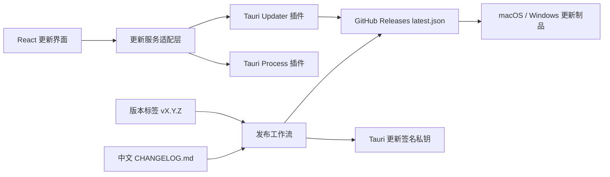

# AgentBridge 应用内手动更新设计

日期：2026-11-16  
状态：待用户审阅

## 背景

AgentBridge 目前通过源代码构建和 `npm run tauri:install` 更新本机开发版。正式分发给同事后，用户无法只靠应用界面获知新版本，也无法在应用内查看更新内容、确认并安装更新。

本功能使用 Tauri 官方 Updater 和 GitHub Releases，提供完整桌面应用升级。安装包可能同时包含 React 前端、Rust 后端、原生依赖、应用资源和新的安装结构，因此不能只热更新前端资源。

## 目标

1. 顶栏显示当前应用版本和“检查更新”按钮。
2. 用户主动检查更新；应用不会在启动、运行或退出时自动下载或安装。
3. 发现新版本后，用户先看到版本号、发布日期和中文更新说明。
4. 用户明确确认后才下载、验证签名、安装并重启。
5. 下载或校验失败时保留当前版本，并显示可执行的中文错误。
6. macOS 和 Windows 使用同一套版本说明与发布状态。
7. 版本标签触发的 GitHub Release 同时提供安装包、更新制品、签名和 `latest.json`。

## 非目标

- 不提供后台静默升级、定时轮询、强制升级或回滚旧版本。
- 不实现 Claude 会话、云端更新服务或自建下载服务。
- 不替代 macOS 代码签名与公证，也不替代 Windows Authenticode 代码签名。
- 不在本轮增加测试版通道、灰度发布、增量差分更新或企业集中管理。
- 不改变现有局域网会话分享、原生导入和数据目录结构。

## 方案选择

### 方案 A：Tauri 官方 Updater 与 GitHub Releases

应用通过 Tauri Updater 读取公开 GitHub Release 中的更新清单，下载对应平台的完整安装包，由 Tauri 验证清单和签名后执行安装。GitHub 仓库已经是公开仓库，不需要新增下载服务器。

这是推荐方案。它直接支持 `app`、`dmg` 和 NSIS 安装结构，能覆盖完整应用更新，并提供签名校验、下载进度和重启能力。

### 方案 B：应用自行下载 GitHub 安装包

前端通过 GitHub API 查询 Release，再调用系统命令打开安装包。

此方案需要自行处理版本比较、平台选择、下载完整性、安装退出顺序和失败恢复，且难以可靠验证制品来源；用户仍需操作系统安装器，因此不采用。

### 方案 C：仅热更新前端资源

应用启动时覆盖本地 Web 资源。

此方案不能更新 Rust 后端、原生插件、签名后的应用主体或安装结构，还会破坏安装包完整性，因此不采用。

## 总体架构



组件职责：

- React 更新界面只负责展示状态、更新说明、进度和确认交互。
- 更新服务适配层封装 `check`、下载状态、安装和重启，便于测试，并避免 UI 直接依赖插件细节。
- Tauri Updater 负责读取版本清单、比较版本、下载、验证签名和调用平台安装器。
- Tauri Process 负责安装完成后的应用重启。
- GitHub Release 是唯一正式更新来源；`latest.json` 只指向同一次发布中的不可变制品。
- 发布工作流负责版本一致性、双平台构建、签名、清单生成和发布门禁。

## 用户流程与界面

### 顶栏入口

顶栏右侧保留现有连接状态，并新增更新区域：

- 显示“当前版本 v0.1.0”。
- 提供“检查更新”按钮。
- 检查过程中按钮显示“正在检查…”，并禁止重复点击。
- 应用启动时不自动调用更新接口。

### 状态与弹窗

更新流程使用一个状态清晰、可由键盘关闭的模态弹窗。检查、下载和安装这三个请求进行中状态除外，避免关闭后丢失正在执行的操作。

1. `检查中`：显示简短加载状态，弹窗暂不关闭，并禁止重复检查。
2. `已是最新版`：显示当前版本、检查时间和“关闭”按钮。
3. `发现新版本`：显示当前版本、新版本、发布日期和 `CHANGELOG.md` 对应版本的中文说明，操作为“稍后再说”和“下载并更新”。
4. `再次确认`：用户点击“下载并更新”后，显示“更新过程中应用将退出并重启；当前版本在下载或签名校验失败时保持不变”，操作为“取消”和“确认更新”。
5. `下载中`：显示百分比、已下载大小和总大小；下载期间禁止重复启动更新，并暂不关闭弹窗。Tauri Updater 当前不公开中止下载的 API，因此界面不展示无法实现的中止按钮。
6. `正在安装`：下载及签名验证完成后显示“正在安装并重启”，界面禁止再次操作。
7. `失败`：显示中文原因、当前版本仍可正常使用的说明和“重试”按钮。

“稍后再说”、关闭弹窗和取消第二次确认都不能触发安装。更新说明按纯文本安全展示，不执行其中的 HTML 或脚本。

### 版本检查频率

- 只有点击“检查更新”才访问更新清单。
- 检查失败不阻止应用启动或现有功能。
- 同一时间只允许一个检查或下载任务。
- 检查结果不持久化为“已下载”；应用重启后恢复空闲状态。
- 本地开发版如需立即安装当前代码，继续使用项目约定的 `npm run tauri:install`。这与正式用户的“不自动升级”不冲突。

## 更新清单与版本规则

公开更新地址：

```text
https://github.com/pumpkifyc/AgentBridge/releases/latest/download/latest.json
```

`latest.json` 使用 Tauri 官方格式，至少包含：

- 规范版本号。
- 发布日期。
- 从 `CHANGELOG.md` 对应版本提取的中文更新说明。
- macOS 与 Windows 目标平台对应的制品 URL 和 Tauri 签名。

正式 macOS 制品使用 universal 应用，`latest.json` 的 `darwin-aarch64` 和 `darwin-x86_64` 映射到经过验证的同一个 universal 更新制品及其签名；Windows 发布 x64 NSIS 制品。两种 macOS 架构和 Windows x64 都必须完成真实升级验证，不能把未验证的架构发布为可用。

`package.json`、`src-tauri/Cargo.toml`、`src-tauri/tauri.conf.json` 和应用版本必须一致。Git 标签必须为 `v` 加同一版本号，例如 `v0.1.1`。发布前发现任何不一致时，工作流失败且不创建正式 Release。

## 中文更新日志

新增仓库根目录 `CHANGELOG.md`，按版本保存用户可读的中文变更：

```markdown
<!-- 以下为格式示意，不代表正式发布内容。 -->
## [0.1.1] - 2026-11-20

### 新增

- 支持在应用内检查、确认并安装新版本。

### 修复

- 修复切换页面后会话列表偶发未刷新的问题。
```

同一份版本段落同时用于：

- 更新弹窗中的说明。
- GitHub Release 正文。
- `latest.json` 的 `notes`。

发布工作流必须从标签对应版本精确提取内容；没有该版本段落的标签不能发布。说明不应包含内部文件清单、密钥、下载凭据或仅开发环境适用的步骤。

## 发布流程

### 配置边界

- 常规分支 CI 继续构建无需更新签名的开发制品。
- 正式发布使用独立的 Tauri 发布配置覆盖文件，将 `createUpdaterArtifacts` 开启。
- Tauri 更新公钥提交到仓库并写入应用配置。
- 私钥和私钥密码只保存在 GitHub Actions Secrets，绝不提交到仓库、写入日志或打包进客户端。
- 应用能力配置只开放 Updater 检查和安装、Process 重启所需的最小权限。

### 触发与构建

新增发布工作流，仅由符合规则的版本标签触发。发布工作流依次执行：

1. 校验标签、`package.json`、Cargo、Tauri 配置和 `CHANGELOG.md` 一致。
2. 运行前端测试、Rust 测试、clippy、打包配置检查和更新清单生成测试。
3. 在 macOS 和 Windows runner 上构建并签名更新制品。
4. 上传 DMG、应用归档、NSIS 安装包、Tauri 更新制品和 `.sig` 签名。
5. 汇总平台制品，生成并校验 `latest.json`。
6. 从 `CHANGELOG.md` 生成 Release 正文。
7. 先创建草稿 Release 并上传全部文件，再执行最终校验。
8. 只有全部平台制品、签名和清单通过后，才公开为正式 Release。

普通提交、拉取请求和手工开发构建不创建正式 Release，也不改变公开的 `latest.json`。

### 发布后验证

发布后先验证匿名访问仓库、下载 URL 和 `latest.json`，再从上一正式版本执行至少一次 macOS 和 Windows 升级。验证失败时停止继续发布新版本，创建修复版本；不覆盖同名制品。

## 安全与完整性

- 更新清单中的每个平台制品必须带 Tauri 签名。
- 下载后签名验证失败时立即删除临时下载，不执行安装器。
- 安装期间使用 Tauri 支持的原子替换或安装器流程；失败时保留现有应用。
- UI 不展示私钥、签名中间值、完整本机路径或凭据。
- 日志只记录版本、阶段和错误类别，不记录签名私钥或更新正文以外的敏感数据。
- Release 发布权限只在正式发布任务的必要步骤使用；验证和构建任务默认只读仓库内容。

### 两类签名

Tauri 更新签名只证明更新制品未被篡改。macOS Gatekeeper 公证和 Windows SmartScreen 信任仍分别依赖 Apple Developer 签名、公证与 Windows 代码签名证书。没有操作系统签名时，首次安装可能出现系统警告；真实应用内更新仍必须在目标平台验证。

## 错误处理

界面将底层错误映射为中文类别并保留“重试”入口：

- 无法连接 GitHub 或请求超时。
- 更新清单不存在、格式无效或没有当前平台制品。
- 远端版本不高于当前版本时显示“已是最新版”，并关闭无效的更新句柄。
- 下载中断或磁盘空间不足。
- Tauri 签名缺失或校验失败。
- 安装器无法启动、应用文件被占用或权限不足。
- 安装完成但重启失败。

任何错误都不能把旧版本标记为已更新。若下载发生在新版本目录中，必须清理不完整文件；若底层安装器已经接管，下一次启动仍应读取实际已安装版本并重新检查，而不是依赖缓存状态。

## 数据与设置

本轮不新增需要长期保存的用户设置。当前版本从应用运行时读取；更新检查、下载和错误状态只保存在当前进程。现有应用数据、导入历史、临时会话包、项目路径和局域网设置不因更新被删除或迁移。

## 测试策略

### 前端与服务适配层

- 启动应用不会调用更新检查。
- 点击“检查更新”只启动一个请求，并显示忙碌状态。
- 无更新时显示当前版本和检查时间。
- 有更新时显示两个版本、发布日期和中文说明。
- 未经过第二次确认不会下载。
- 下载进度、安装和重启状态按顺序显示。
- 重复点击不会创建并行任务。
- 网络、清单、下载、签名和安装错误均显示中文原因，并允许重试。
- 更新说明按纯文本渲染，不执行 HTML。

### 配置与发布脚本

- 更新公钥、endpoint、最小能力和最新清单地址配置正确。
- 常规 CI 不需要发布私钥，正式发布配置开启更新制品。
- 标签、应用版本和 `CHANGELOG.md` 不一致时发布失败。
- `latest.json` 的 URL、版本、日期、说明和平台映射正确。
- 缺少任一平台签名或制品时不发布。
- Release 正文与应用内说明来自同一中文版本段落。

### 双平台集成

- 从上一正式版本通过应用内按钮升级到新版本。
- 验证前端、Rust 功能、原生依赖和安装路径都已更新。
- 验证升级后应用能重启，现有应用数据和导入记录保持不变。
- 模拟网络中断、坏签名、磁盘空间不足和安装文件被占用，确认旧版本仍可启动。
- 验证公开下载不登录 GitHub 也能完成。

## 发布门槛

- `npm test -- --run`、`npm run test:e2e-config`、Rust 测试和 clippy 通过。
- macOS 与 Windows 发布工作流均构建上传完整制品、签名和 `latest.json`。
- 至少一个上一正式版本到新版本的真实应用内升级在两端完成。
- 升级失败场景不会删除用户数据或破坏当前可运行版本。
- 文档明确区分 Tauri 更新签名与 macOS/Windows 操作系统签名。
- 桌面版功能通过验证后，按项目约定执行 `npm run tauri:install` 安装当前平台最新构建。

## 验收标准

- 顶栏显示当前版本，用户可主动点击“检查更新”。
- 有更新时，用户先看到版本、日期和中文更新说明，再经过明确确认才开始下载。
- 下载进度可见；下载和签名验证成功后安装并重启。
- 已是最新版、网络失败、坏签名和安装失败都有清晰中文反馈。
- 应用不会自动检查、下载或安装更新，也不会在后台静默升级。
- 正式更新只由版本标签发布，普通 CI 不改变用户收到的版本。
- 更新不会删除现有应用数据；macOS 和 Windows 完整升级均通过真机验收。
